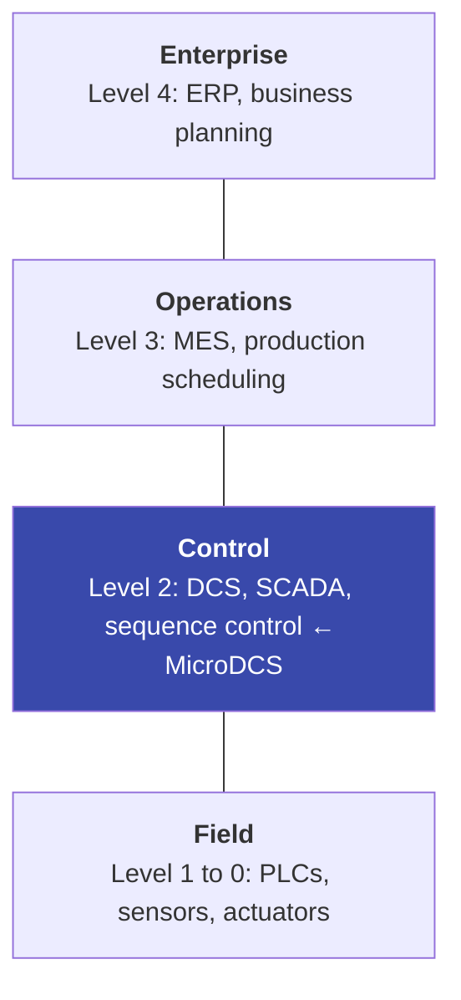

# Concepts at a Glance

This page introduces the terms you need before you work with MicroDCS. Each section is short and links to the page
with the details.

## Domain concepts

### OT and the ISA-95 levels

MicroDCS is **operational technology (OT)** software: it controls a physical manufacturing process. ISA-95 describes
the levels of systems in a plant:

**Northbound** means up the levels, toward the MES. **Southbound** means down, toward controllers and equipment. The
direction decides what a processor subscribes to and publishes ([binding direction](#binding-direction)). More on ISA-95
in [Information Model Standards](information-model-standards.md).

### OPC UA companion specifications

MicroDCS does not use OPC UA as a transport (no client/server, no PubSub). It uses the OPC UA **information models**:
the data types, state machines and methods of companion specifications, carried as CloudEvent payloads over MQTT or
NATS. The main one is [OPC 40001-3 Machinery Job Management](https://reference.opcfoundation.org/Machinery/Jobs/v100/docs/)
with ISA-95 Job Control: job orders, job responses and the job order state machine (Store, Start, Pause, Resume, Stop,
Abort, Cancel, Clear).

### Job orders, Work Masters and station configuration

A **job order** says what to produce; a **job response** reports how it went; a **Work Master** is the template a job
order refers to. MicroDCS adds a Work Master subtype that carries a **recipe** (`Data` plus `DataSchema`), which the SFC
engine runs.

The MES also pushes the **station configuration**: lists of allowed equipment, material classes and definitions,
personnel and physical assets, the Work Masters, and a limit of stored job orders. A job order that needs something not
on the lists is refused. Each list entry is a CloudEvent; the `method` attribute `DELETE` removes it, anything else
stores it ([Information Model Standards](information-model-standards.md#station-configuration)).

## Framework concepts

### CloudEvents

Every message is a [CloudEvent](https://cloudevents.io/). Processors see it as an `EventEnvelope`.

| Attribute | Purpose |
|---|---|
| `type` | The kind of event, for example `com.github.aschamberger.microdcs.greetings.hello.v1`. Selects the handler. |
| `source` | The producer (`MicroDcs:CloudEventSource` for events this application creates). |
| `id` | Unique per `source`; a re-sent duplicate keeps it. The pipeline deduplicates on it. |
| `subject` | `scope[/resource]`, where the scope is a dotted path such as `plant1.line2`. |
| `dataschema` | URI of the payload's JSON Schema. |
| `datacontenttype` | `application/json; charset=utf-8` for JSON and OPC UA JSON payloads. |
| `correlationid` | Groups the events of one flow (for SFC commands: the job id). |
| `causationid` | The `id` of the event that caused this one. A response sets it to the command's `id`. |
| `expiryinterval`, `expirytime` | When the event is no longer useful. |
| `traceparent`, `tracestate` | W3C trace context. |

MicroDCS extensions: `method` (`PUT`/`DELETE`), `mdcsactionkey` (stable key of an SFC command) and the error
attributes `mdcserrorkind`, `mdcserrormessage`, `mdcserrorcontext` ([Technical Standards](technical-standards.md#cloudevents)).

### Payloads

A payload is a C# record or class marked `[CloudEventType]` with its type id and schema. JSON payloads use a
source-generated `JsonSerializerContext`; OPC UA structures use the `OpcUaJson` codec. A field marked `[CarriedAs]`
travels as a CloudEvent extension attribute instead of in the body, and is copied from a request to its reply
([Processors](processors-dotnet.md#a-payload)).

### Processor

A **processor** is a `partial` class marked `[Processor]` with handler methods. It handles one domain (greetings, job
control, a tightening controller) and does not know which transport carries its messages. A source generator wires the
handlers at build time; there is no base class and no reflection.

| Handler | Runs when |
|---|---|
| `[Incoming]` | An event of the payload's type arrives. What it returns is published as the reply. |
| `[Outgoing(typeof(T))]` | The SFC engine or application code sends a command of type `T`; the factory builds the payload. |
| `[OnResponse]` | A response to a command this instance sent arrives. |
| `[OnExpired]` | A command expired without a response. |
| `[Fallback]` | No other handler claims the event. |
| `[OnInitialize]`, `[OnStarted]`, `[OnShutdown]` | Lifecycle. `[OnStarted(Singleton = true)]` runs on one replica only. |

To publish outside a handler, inject `IEventPublisher`. See [Your First Processor](your-first-processor.md) and
[Processors](processors-dotnet.md).

### Binding direction

Every processor has a binding direction, `ProcessorBinding.Northbound` or `ProcessorBinding.Southbound`:

| Direction | Subscribes to | Publishes to | Role |
|---|---|---|---|
| `Northbound` | `commands` | `data`, `events`, `metadata` | Does the work: takes commands from above and reports back up. The Machinery Jobs processor is northbound. |
| `Southbound` | `data`, `events`, `metadata` | `commands` | Directs: watches the equipment below and sends it commands. Equipment processors are southbound. |

### Intent and address

Each message has an **intent**, which is the last segment of its address:

| Intent | Segment | Meaning |
|---|---|---|
| `Data` | `data` | Measured values, state variables. |
| `Event` | `events` | Something that happened. |
| `Command` | `commands` | An instruction to execute. |
| `Meta` | `metadata` | Capabilities and configuration, often retained. |

A **binding** places a processor in the address space, configured under `MicroDcs:Bindings:{id}`: an address prefix, a
number of scope levels, an optional discriminator and the transport. On MQTT an address looks like
`{Prefix}/{scope…}/{Discriminator}/{intent}`, for example `dcs/plant1/line2/greetings/events`; on NATS the separator is
`.`. The scope in the address must match the scope in the subject, or the message is dropped
([D-38](porting/decisions.md#d-38)).

### Transport and pipeline

A **transport** connects to a broker and turns its messages into envelopes: MQTT 5, NATS JetStream, or in-memory for
tests. One **pipeline** serves all transports. For each received message it claims the event id in Valkey (so a
duplicate is not processed twice), checks the scope, decodes the payload, runs the handler, publishes the replies and
then lets the transport acknowledge. A handler that throws leaves the message unacknowledged for redelivery
([Processors](processors-dotnet.md#pipeline)).

Outgoing events go to a bounded queue per binding. A full queue fails the publish with an error instead of blocking
([D-28](porting/decisions.md#d-28)).

### Instance roles

`MicroDcs:Roles` decides what an instance runs: `Processor` (transports, processors, SFC engine), `Publisher` (state
topic publishers) or `All` (both, the default). Production runs both roles as separate Deployments; development uses
`All` in one container ([Deployment](deployment.md)).

### State topics and the job order publisher

A **state topic** holds the last value of something: a retained message on MQTT, a key-value entry on NATS. The **job
order publisher** keeps state topics for the MES: one `order/{id}` and `result/{id}` per job and a `state-index` per
scope. It reads the change stream that every job write appends to, so a command never waits for the MES side
([Machinery Jobs – MES Publishing](machinery-jobs-mes-publishing.md)).

### Valkey

[Valkey](https://valkey.io/) holds all state: dedupe claims, job orders and responses, Work Masters and station lists,
SFC job state, work and change streams, leases. Documents are versioned hashes with explicit index keys; every write
that can race is a compare-and-set script ([Persistence](persistence.md)).

### SFC engine

The **SFC engine** runs the recipe of each job order: steps, transitions, actions that send commands to the equipment or
wait for its events. Its logic is a pure function; the host around it runs on every processor instance and coordinates
through Valkey ([SFC Engine](sfc-engine.md)).

### Inspection and the management listener

Every stateful component has an **inspector**, a read-only view of its state. The optional **management listener** serves
health probes, a read-only REST API and, in development, an MCP server with inspection and maintenance tools
([Inspection and MCP](inspection.md), [HTTP surface](observability.md)).

## Glossary

| Term | Meaning |
|---|---|
| **Action** | Work bound to an SFC step: a `push_command` or a `pull_event`. |
| **Action key** | `{jobId}:{action}`, sent as `mdcsactionkey`. The same on every re-delivery of a command; equipment deduplicates on it. |
| **Binding** | Configuration that places one processor on one transport: prefix, scope levels, discriminator, shared group, reply base. |
| **Binding direction** | `Northbound` or `Southbound`; decides the intents a processor subscribes to and publishes. |
| **Change stream** | Valkey stream per scope that every job order or response write appends to. The job order publisher reads it. |
| **CloudEvent** | The CNCF envelope every MicroDCS message uses. |
| **Command id** | The `id` of one command delivery, `{actionKey}#{n}`; new for every attempt. |
| **Compare-and-set** | A Valkey script that writes only if the stored version is the one the caller read. |
| **Dedupe claim** | Valkey key per event id that keeps a second delivery of the same event from running the handler again. |
| **Discriminator** | Address segment that separates processors sharing a prefix. |
| **Divergence** | SFC branching: selection (one sequence is taken) or simultaneous (all sequences run). Called `Branches` in the recipe. |
| **Due-index** | Valkey sorted set of SFC jobs by their next deadline. Every instance sweeps it. |
| **Equipment hold** | Hold and restart commands an SFC action may declare, sent on Pause and Resume. |
| **Inspector** | Read-only view of a component's state for diagnostics. |
| **Instance role** | `Processor`, `Publisher` or `All`. |
| **Intent** | `Data`, `Event`, `Command` or `Meta`; the last segment of an address. |
| **Island** | One independent deployment with its own Valkey and key prefix. High availability comes from several islands, not from a cluster ([D-12](porting/decisions.md#d-12)). |
| **Job order** | ISA-95 order to produce something, with its state in the job order state machine. |
| **Outcome** | How an SFC action ended (`done`, a declared name, `timeout`, `error`). Transitions name outcomes. |
| **Pipeline** | The single path every received message takes, for every transport. |
| **Processor** | Class with handlers for one domain, marked `[Processor]`. |
| **Pull event** | SFC action that waits for an event from the equipment. |
| **Push command** | SFC action that sends a command and waits for the response. |
| **Recipe** | SFC definition in a Work Master's `Data`: steps, transitions, actions, divergences. |
| **Reply address** | Per-instance address where responses to this instance's commands arrive (`{ReplyBase}/{instance}`). |
| **Scope** | Dotted path such as `plant1.line2`, the first part of `subject` and the scope levels of the address. Job orders, lists and SFC work are kept per scope. |
| **State index** | State topic per scope with the sequence number and the state of every job. The MES uses it to detect missed changes. |
| **State topic** | Last-value topic: retained on MQTT, key-value on NATS. |
| **Station configuration** | Resource lists, Work Masters and the order limit that the MES pushes per scope. |
| **Step** | SFC state; its actions run while it is active. |
| **Transition** | SFC edge between steps; fires when its condition matches an outcome. |
| **Work Master** | ISA-95 template referenced by a job order; the MicroDCS subtype carries a recipe. |
| **Work stream** | Valkey stream per scope (`sfc:work:{scope}`) through which SFC work is shared between instances. |
