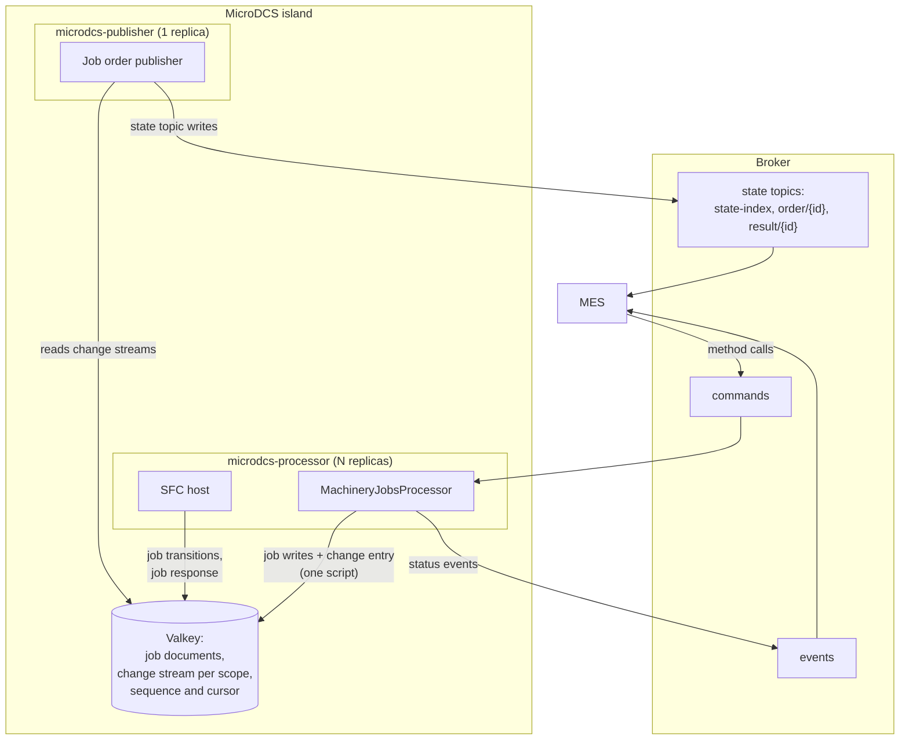
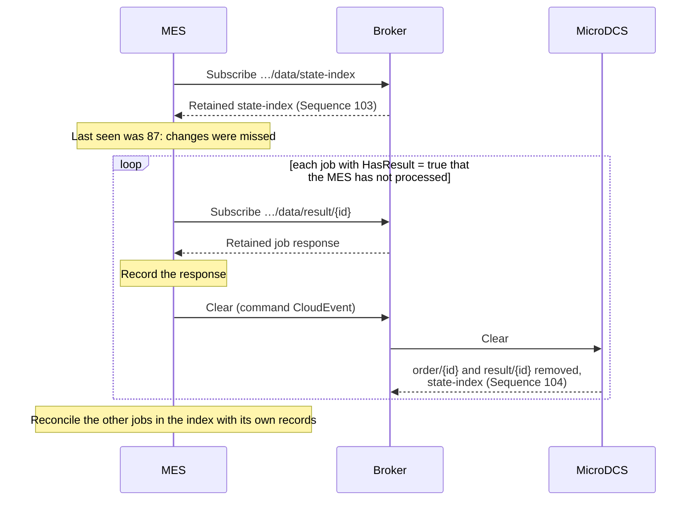

# Machinery Jobs – MES Publishing

This page explains how MicroDCS keeps job order state and job responses available to the MES across connectivity
outages, and what an MES has to do to resync. The configuration and the inspector are in
[Job models and state machine](job-control.md#job-order-publisher).

## Background

[OPC 40001-3 Machinery Job Management](https://reference.opcfoundation.org/Machinery/Jobs/v100/docs/) offers two ways
to expose job state to clients:

* **Event-based.** Clients receive an `ISA95JobOrderStatusEventType` event on each state transition. The Machinery Jobs
  processor publishes these as CloudEvents on its `events` address. Events are fast, but a client that misses one has no
  way to notice.
* **List-based.** `JobOrderList` and `JobOrderResponseList` always show the current state. MicroDCS maps them to state
  topics, which a reconnecting client reads at once.

### Why events alone are not enough

The MES creates and controls job orders, but the station drives the state transitions and produces the job response
data (serial numbers, set-point and actual torques, temperatures, machine ids). If the MES misses a status event during
an outage, it cannot rebuild the state from its own records. In high-cadence production, dozens of jobs can end during a
30-minute outage. The MES acknowledges a job response with `Clear`; until then the job and its response stay in Valkey,
and the state topics show them.

### Why not one retained list

Publishing the whole `JobOrderList` or `JobOrderResponseList` on every transition would resend large, mostly unchanged
payloads. Job orders carry all their requirements; a job response in traceability-heavy production can be several
kilobytes. MicroDCS therefore splits the state into one topic per job order, one per job response, and a small index.

## Design



* Every write of a job order or a job response appends an entry to the scope's **change stream** in the same Valkey
  script, so no change is lost between the write and the publish. No processor knows about the publisher.
* The **job order publisher** reads the change streams and writes the state topics through the transport's state topic
  port: retained messages on MQTT, a key-value bucket on NATS. A command never waits for it.
* The publisher runs in its own Deployment with `MicroDcs:Roles=Publisher`. The processors are latency-sensitive and
  scale out; the publisher is a single writer, throughput-oriented, and may use another broker. Separate Deployments
  give separate restarts, limits and alerts. With `Roles=All` both run in one process
  ([Deployment](deployment.md#shape)).
* A lease in Valkey keeps a second publisher from writing during a rolling update. A publisher restart takes seconds; the
  MES reads the retained values in the meantime, so no leader election is needed beyond the lease.

### Topics

The state topics are siblings of the processor's `data` address:
`{Prefix}/{scope levels}/{Discriminator}/data/…`, the same address the `machinery_jobs` binding uses.

| Topic | Payload | Written |
|---|---|---|
| `…/data/state-index` | `JobOrderStateIndexDataType` | After every batch of changes of the scope |
| `…/data/order/{id}` | `ISA95JobOrderDataType`, without state | On Store, StoreAndStart and Update; removed on Cancel and Clear |
| `…/data/result/{id}` | `ISA95JobResponseDataType` | When a job in Completed, Closed or Aborted has a response; removed on Cancel and Clear |
| `…/events` | `ISA95JobOrderStatusEventType` CloudEvent | On each transition with an effect (not a state topic) |
| `…/metadata` | `org.opcfoundation.Machinery.Jobs.Meta.v1`, retained | Once at start, by one replica |

All state topic values are CloudEvents with OPC UA JSON payloads. Each has a time to live (`RetainedTtl`, 48 h by
default): on MQTT the message expiry of the retained message, on NATS the per-message TTL in the bucket. The publisher
refreshes every topic at half that time, so a topic disappears only when its scope is no longer served. A removed topic
is a zero-byte retained message on MQTT and a deleted key on NATS.

`order/{id}` and `result/{id}` are written rarely and are large; `state-index` changes often but is small. A result is
published once the job has ended, not while it runs, so the MES never sees a partial response.

The job order id is a topic level, so it may only contain letters, digits, `_` and `-`. A Store, StoreAndStart or Update
with another id is answered with `InvalidRequest`.

### State index

```json
{
  "Sequence": "103",
  "Scope": "plant1.line2",
  "PublishedAt": "2026-11-13T14:23:01Z",
  "Jobs": [
    {"JobOrderID": "JO-0441", "State": [{"BrowsePath": {…}, "StateText": {"Locale": "en", "Text": "Running"}, "StateNumber": 3}], "HasResult": false},
    {"JobOrderID": "JO-0442", "State": [{"BrowsePath": {…}, "StateText": {"Locale": "en", "Text": "Ended"}, "StateNumber": 5}, {"BrowsePath": {…}, "StateText": {"Locale": "en", "Text": "Completed"}, "StateNumber": 1}], "HasResult": true}
  ]
}
```

* `Sequence` grows with every index of the scope and survives restarts. It is a JSON string because OPC UA JSON writes
  every `Int64` as one.
* `State` is the ISA-95 state array: the top-level state and, where one applies, its sub-state.
* `HasResult` is true when the `result/{id}` topic exists.

The schema is [`JobOrderStateIndexDataType`](https://aschamberger.github.io/microdcs/schemas/microdcs-jobcontrol/v1.2.0.json).

### Rebuild

The publisher rebuilds a scope from the stored documents (all topics and a new index with a higher `Sequence`):

* on its first visit of the scope after it took the lease,
* when its cursor in the change stream is missing,
* when the change stream was trimmed past the cursor (`MicroDcs:Valkey:ChangeStreamMaxLength`),
* at half the time to live, so idle orders keep their topics.

Delivery is at least once: after a crash the publisher may write a topic again with the same content.

## Reconnect and resync



1. Subscribe to `state-index` and compare `Sequence` with the value last read. Equal means nothing was missed. Higher
   means: read the index again and act on it. A rebuild also raises it.
2. For each job with `HasResult`, read `result/{id}`, record it, then call `Clear`.
3. Read `order/{id}` for jobs the MES does not know in the listed state, and reconcile.

On NATS the same steps use the key-value bucket (`StateBucket`): read the key, or watch it.

## Clear and Cancel

`Clear` is the MES acknowledgement that it has the job response. It is allowed in Ended and Aborted. `Cancel` removes an
order that has not started. Both delete the job order in Valkey and append a change entry; the publisher then removes
`order/{id}` and `result/{id}` and drops the job from the index. The job response document stays in Valkey.

During an outage the jobs wait in Ended or Aborted with their responses on the broker until the MES reconnects and
works through them. The time to live is the safety net for a job that is never cleared, for example after a machine
fault; as long as the publisher runs, it refreshes the topics, so they stay.

## MES integration checklist

| Item | Value |
|---|---|
| Commands | `{Prefix}/{scope levels}/{Discriminator}/commands` with the Job Control V2 method types; each call gets a response of type `….response.v2` on the caller's response topic. |
| Status events | `…/events`, type `org.opcfoundation.ISA95-JOBCONTROL_V2.ISA95JobOrderStatusEventType.v2`. |
| State | `…/data/state-index`, `…/data/order/{id}`, `…/data/result/{id}`, retained (MQTT) or in the key-value bucket (NATS). |
| Encoding | CloudEvents in binary content mode, OPC UA JSON (verbose) payloads; `Int64` and `UInt64` values are strings. |
| Broker | Retained messages must be persistent (Mosquitto `persistence true`), otherwise a broker restart empties the state until the next rebuild. |
