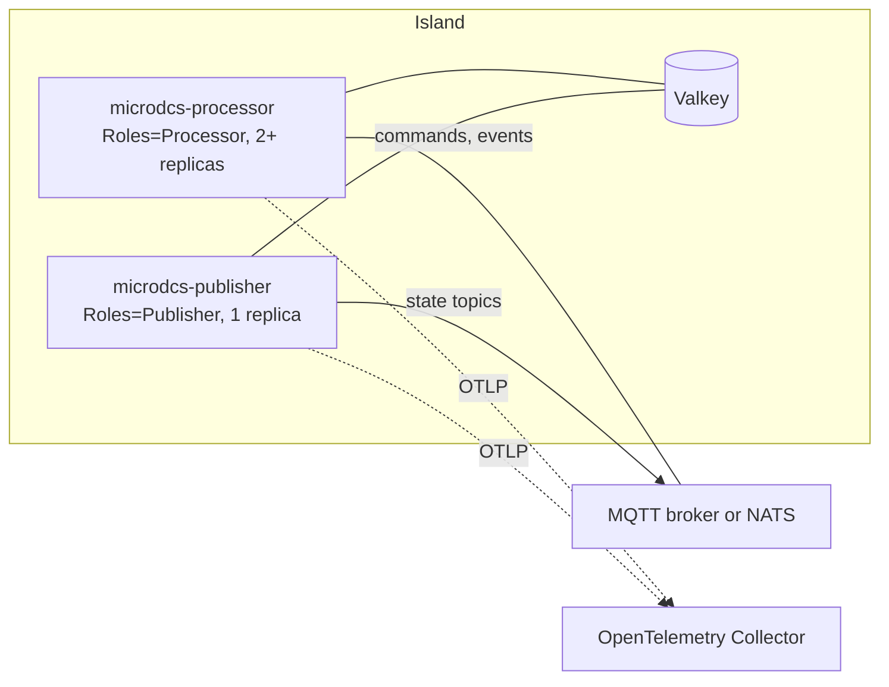

# Operations

This page covers running MicroDCS in production: what the dependencies need, what happens when one fails, the full
configuration reference, backpressure, shutdown, monitoring and sizing. The Kubernetes manifest and its limits are on
[Deployment](deployment.md), the trust model and hardening on [Security](security.md).

## Deployment model {#deployment-model}

An island is one independent deployment with its own Valkey: a plant area, a line or a site
([D-12](porting/decisions.md#d-12)). Inside it the same image runs in two roles:



Each process runs one .NET Generic Host. Transports deliver messages to a fixed number of workers per transport
(`MessageWorkers`); outgoing events go through one bounded queue per binding. Knowing where those queues are and what
happens when they fill is the basis for running the system ([Backpressure](#backpressure)).

## Valkey {#valkey}

Valkey is the system of record: job orders and responses, SFC state, work and change streams, dedupe claims and leases
([Persistence](persistence.md)).

**Version.** Plain Valkey without modules is enough; the project tests with `valkey/valkey-bundle:9`. One endpoint, no
cluster mode. A replica with Sentinel or an operator needs no code change.

**Persistence baseline.** Run with an append-only file on a persistent volume:

```bash
valkey-server --appendonly yes --appendfsync everysec
```

With only the default snapshots, a crash loses every write since the last snapshot, including job orders the MES was
told were stored. With `appendfsync everysec` at most about one second of writes can be lost. Mount the data directory
(`/data` in the official image) on a persistent volume, otherwise a rescheduled pod starts empty. The dev stack in
`compose.yaml` uses these settings.

**Access.** One ACL user per island with only the commands and keys MicroDCS needs
([`deploy/valkey-island-acl.conf`](https://github.com/aschamberger/microdcs/blob/main/deploy/valkey-island-acl.conf),
[Security](security.md#valkey)).

**What a Valkey outage does.**

* At start, the connection is checked once; without Valkey the process ends and Kubernetes restarts it with a growing
  back-off ([D-27](porting/decisions.md#d-27)).
* At runtime the client reconnects on its own. Commands sent during the outage fail after a few seconds; `/health/ready`
  reports `valkey` as failing, so the pod leaves the Service endpoints.
* A received message whose dedupe claim or done mark fails gets the outcome `Retry`; one whose handler fails on Valkey
  is a `Fault`. On MQTT both end the process, and the broker redelivers the unacknowledged message to the persistent
  session after the restart. On NATS the process keeps running: a `Retry` stays with its worker and runs again every `NakDelay`
  until Valkey answers, without using a delivery, while a handler `Fault` counts, so a Valkey outage longer than
  `MaxDeliver` × `NakDelay` (about 20 s by default) terminates messages whose handler needs Valkey (`microdcs.nats.poisoned`).
  Raise `NakDelay` or `MaxDeliver` if the island must ride out longer outages.
* The poller, the SFC sweep and the job order publisher log the error, count it (`microdcs.valkey.poll.errors`,
  `microdcs.jobs.publisher.*`) and try again on the next round. A failed SFC work entry stays pending and is taken
  again after `AutoclaimIdle`. A write whose outcome is unknown is checked and repeated (`WriteAttempts`).
* After the outage the first sweep sees the heartbeat gap and moves every SFC deadline by it, so running jobs do not
  time out because of the outage.

### Recovery objectives {#recovery-objectives}

These follow from the design and its tests. They are not measured service levels; measure them in your own
deployment before you commit to a target.

| Event | Data loss | Time to recover |
|---|---|---|
| Valkey crash, AOF `everysec` on a persistent volume | About 1 second of writes at most | Valkey restart, then MQTT replicas restart (see above) |
| Valkey crash, snapshots only | Everything since the last snapshot | As above |
| Valkey graceful stop and start | None | As above |
| Valkey failover to an asynchronous replica | The last writes not yet replicated | Failover time |
| A processor pod dies | None: unacknowledged messages are redelivered, work entries are claimed again | Other replicas keep serving; its SFC work is claimed after `AutoclaimIdle` (30 s), its unanswered commands are resent when their deadlines pass |
| The publisher pod dies | None | Pod restart; the MES reads the retained state meanwhile, the lease lets the new pod take over after `LeaseTtl` (15 s) |
| A command response is lost with its instance | None | Until the action's deadline sends the command again ([D-9](porting/decisions.md#d-9)) |

Kubernetes caps the restart back-off at five minutes, so the time to recover from a long Valkey outage is the outage plus
pod start plus the current back-off. Messages are delivered at least once: a message in flight at a crash is processed
again after its dedupe lease (`DedupeLease`, 30 s) ends, and commands to equipment can be repeated.

## Broker {#broker}

* **MQTT 5** with retained messages and persistent sessions that survive a broker restart (Mosquitto:
  `persistence true` and a persistent volume). Without persistence a broker restart empties the MES state topics until
  the next refresh and loses messages for disconnected instances. Shared subscriptions (`$share/…`) must be supported.
  Set the maximum packet size deliberately ([limits](deployment.md#limits)).
* **NATS** with JetStream and file storage. MicroDCS creates its streams, consumers and the state bucket itself, so its
  user needs the JetStream API permissions for them ([Security](security.md#acl)).

## Configuration reference {#configuration-reference}

Configuration is the .NET configuration section `MicroDcs`. `microdcs serve` reads environment variables with the prefix
`APP_` and `__` as the section separator: `MicroDcs:Valkey:KeyPrefix` is `APP_MicroDcs__Valkey__KeyPrefix`. Durations
use the .NET `TimeSpan` format (`00:00:30`); lists are comma-separated strings without escaping
([D-30](porting/decisions.md#d-30)). Every invalid value ends the process at start with the field name in the message
([D-27](porting/decisions.md#d-27)). Paths to secrets point at mounted files; secrets are never logged.

### Core (`MicroDcs`) {#config-core}

| Name | Type | Default | Description |
|---|---|---|---|
| `CloudEventSource` | string | none, required | `source` of events this application creates. |
| `InstanceId` | string | `POD_ID` or a generated id | Instance id: part of the dedupe token, the reply address and `service.instance.id`. |
| `Roles` | `Processor`, `Publisher`, `All`, `None` | `All` | What this instance runs ([instance roles](overall-design.md#instance-roles)). |
| `MessageExpiry` | duration | none | Expiry interval of created events. A command with an expiry and a reply address starts a local timer that `[OnExpired]` answers. |
| `ShutdownGracePeriod` | duration | 30 s | Time for in-flight work on shutdown. |
| `OutgoingQueueMaxSize` | int | 1000 | Upper bound of any outgoing queue ([D-28](porting/decisions.md#d-28)). |
| `MessageWorkers` | int | 5 | Parallel workers per transport. |
| `DedupeLease` | duration | 30 s | Lease of a dedupe claim; must exceed the slowest handler. |
| `DedupeRetention` | duration | 10 min | How long a processed event stays a duplicate. Keep it above the broker's redelivery window. |
| `StartLeaseTtl` | duration | 30 s | Lifetime of the lease of an `[OnStarted(Singleton = true)]` hook. |

### Bindings (`MicroDcs:Bindings:{id}`) {#config-bindings}

`{id}` is the processor's binding id (`[Processor(Id = …)]`): `greetings` and `machinery_jobs` in `microdcs serve`.

| Name | Type | Default | Description |
|---|---|---|---|
| `Transport` | string | `mqtt` | `mqtt`, `nats` or `memory`; the transport must be registered. |
| `Prefix` | string | none, required | Address prefix; `/`-separated segments of letters, digits, `_` and `-`. |
| `ScopeLevels` | int | 0 | Scope levels below the prefix. |
| `Discriminator` | string | none | Separates processors that share a prefix; prefix and discriminator together are unique. |
| `ReplyBase` | string | none | Base of this instance's reply address (`{ReplyBase}/{InstanceId}`). Required when the processor sends commands. |
| `SharedGroup` | string | none | Competing-consumer group: MQTT shared subscription or NATS shared consumer. Without it every instance receives every message. |
| `ScopeCheck` | `Enforce`, `Off` | `Enforce` | Compare the subject's scope with the address scope ([D-38](porting/decisions.md#d-38)). |
| `Level0Subjects` | `Reject`, `Accept` | `Reject` | Subjects on addresses without scope levels. |
| `OutgoingQueueSize` | int | 0 | Outgoing queue of the binding; 0 means `OutgoingQueueMaxSize`, a larger value ends the start. |
| `OutgoingTypeFilter` | string | none | Comma-separated event type ids or patterns (`*`, `?`) the binding may publish; empty allows all. |
| `AllowedReplyPrefixes` | string | none | Comma-separated prefixes a peer's reply address must start with; empty allows every address the built-in rules accept ([D-48](porting/decisions.md#d-48)). |

### MQTT (`MicroDcs:Mqtt`) {#config-mqtt}

| Name | Type | Default | Description |
|---|---|---|---|
| `Hostname` | string | `localhost` | Broker host. |
| `Port` | int | 1883 | Broker port. |
| `ClientId` | string | `microdcs-{instance id}` | MQTT client id; instances must not share one. |
| `Username` | string | none | User name. |
| `Password` | string | none | Password; needs `Username`. Prefer `PasswordFile`. |
| `PasswordFile` | path | none | File with the password; one trailing line break is removed. Not together with `Password`. |
| `SatTokenFile` | path | `/var/run/secrets/tokens/broker-sat` | Kubernetes service account token, used as enhanced authentication (`K8S-SAT`) when the file exists. |
| `TlsCaFile` | path | `/var/run/certs/ca.crt` | CA of the broker certificate. When the file exists the connection uses TLS and trusts only this CA. |
| `RequireTls` | bool | `false` | End the start when `TlsCaFile` does not exist instead of connecting in plain text. |
| `TlsClientCertFile`, `TlsClientKeyFile` | path | none | PEM client certificate and key for mutual TLS; set together, need TLS. |
| `SessionExpiry` | duration | 1 h | How long the broker keeps the session after a disconnect. |
| `KeepAlive` | duration | 30 s | Keep-alive period. |
| `OperationTimeout` | duration | 15 s | Timeout of connect, subscribe and publish. |
| `ReconnectMinDelay`, `ReconnectMaxDelay` | duration | 1 s, 30 s | Wait before a reconnect attempt; doubles up to the maximum. |
| `PublishQos` | int | 1 | QoS of published messages, 0 or 1. With 0 the transport is at-most-once and the dedupe claim is skipped. |

Details: [MQTT transport](mqtt-transport.md).

### NATS (`MicroDcs:Nats`) {#config-nats}

| Name | Type | Default | Description |
|---|---|---|---|
| `Url` | string | `nats://localhost:4222` | Server URL; several separated by commas. |
| `ClientName` | string | `microdcs-{instance id}` | Connection name shown by the server. |
| `Username`, `Password` | string | none | User and password. Prefer `PasswordFile`. |
| `PasswordFile` | path | none | File with the password. Not together with `Password`. |
| `TokenFile` | path | none | File with an authentication token. |
| `CredsFile` | path | none | `.creds` file (JWT and NKey seed); it selects the account. |
| `NKeyFile` | path | none | File with an NKey seed. |
| `TlsCaFile` | path | `/var/run/certs/ca.crt` | CA of the server certificate. When the file exists the connection uses TLS and trusts only this CA. |
| `RequireTls` | bool | `false` | End the start when `TlsCaFile` does not exist. |
| `TlsClientCertFile`, `TlsClientKeyFile` | path | none | PEM client certificate and key for mutual TLS. |
| `JetStreamDomain` | string | none | JetStream domain (leaf nodes). |
| `StreamPrefix` | string | `MDCS` | Prefix of the stream names. |
| `StreamMaxAge` | duration | 24 h | How long a stream keeps an unacknowledged message; zero is unlimited. |
| `Replicas` | int | 1 | Replicas of streams, consumers and the state bucket (1 to 5). |
| `ConsumerInactiveThreshold` | duration | 1 h | The server removes a consumer no client used for this long. |
| `AckWait` | duration | 30 s | Time the server waits for an acknowledgement before it redelivers. |
| `MaxDeliver` | int | 5 | Delivery attempts; the last failed one terminates the message. |
| `NakDelay` | duration | 5 s | Wait before a failed message is redelivered. |
| `StateBucket` | string | `microdcs-state` | Key-value bucket for state topics. |
| `OperationTimeout` | duration | 15 s | Timeout of connect, set-up and publish round trips. |
| `ReconnectMinDelay`, `ReconnectMaxDelay` | duration | 1 s, 30 s | Wait between reconnect attempts. |

Use one authentication method. Details: [NATS transport](nats-transport.md).

### Valkey (`MicroDcs:Valkey`) {#config-valkey}

| Name | Type | Default | Description |
|---|---|---|---|
| `ConnectionString` | string | `localhost:6379` | StackExchange.Redis connection string. `microdcs serve` uses Valkey only when it is set. Never logged; prefer `PasswordFile` for the password. |
| `User` | string | none | ACL user; overrides `user=` in the connection string. |
| `PasswordFile` | path | none | Password file, read before every connect attempt so a rotated password reaches the next reconnect ([D-49](porting/decisions.md#d-49)). Not together with `password=` in the connection string. |
| `TlsCaFile` | path | none | PEM CA of the server certificate; turns TLS on and trusts this CA besides the system store. `ssl=true` in the connection string uses the system store only. |
| `RequireTls` | bool | `false` | End the start when neither `TlsCaFile` nor `ssl=true` turns TLS on. |
| `KeyPrefix` | string | `microdcs` | Prefix of every key, one per island. No `*?[]\` and no trailing `:`. |
| `PollInterval` | duration | 1 s | Fallback read of all streams when no nudge arrives. |
| `ScopeRefreshInterval` | duration | 5 s | Read of the scope registry. |
| `WriteAttempts` | int | 4 | Attempts of a write whose outcome is unknown after a connection error. |
| `WriteRetryDelay` | duration | 100 ms | Pause before such a write is checked and repeated. |
| `ChangeStreamMaxLength` | int | 5000 | Approximate length of each change stream. |

Details: [Valkey layer](valkey-layer.md).

### Job acceptance (`MicroDcs:JobAcceptance`) {#config-job-acceptance}

| Name | Type | Default | Description |
|---|---|---|---|
| `CheckEquipmentId` | bool | `true` | Equipment requirements must be in the scope's list. |
| `CheckMaterialClassId` | bool | `true` | Material classes must be in the scope's list. |
| `CheckMaterialDefinitionId` | bool | `true` | Material definitions must be in the scope's list. |
| `CheckPersonnelId` | bool | `true` | Personnel requirements must be in the scope's list. |
| `CheckPhysicalAssetId` | bool | `true` | Physical asset requirements must be in the scope's list. |
| `CheckWorkMaster` | bool | `true` | Work Masters must be known in the scope. |
| `CheckMaxDownloadableJobOrders` | bool | `true` | Limit the number of job orders of a scope. |
| `MaxDownloadableJobOrders` | int | 0 | Limit for a scope without its own; 0 means no limit. A limit set through `config.jobacceptance` always applies, also 0, which accepts nothing. |

Details: [Machinery Jobs processor](job-control.md#machinery-jobs-processor).

### Job order publisher (`MicroDcs:JobPublisher`) {#config-job-publisher}

| Name | Type | Default | Description |
|---|---|---|---|
| `RetainedTtl` | duration | 48 h | How long a state topic stays when nothing refreshes it; topics are refreshed at half of this. At least 2 s. |
| `ReadCount` | int | 50 | Most change entries per scope in one round. |
| `LeaseTtl` | duration | 15 s | Lifetime of the publisher lease, renewed at a third of it. At least 3 s. |

Details: [Machinery Jobs – MES Publishing](machinery-jobs-mes-publishing.md).

### SFC host (`MicroDcs:Sfc`) {#config-sfc}

| Name | Type | Default | Description |
|---|---|---|---|
| `Enabled` | bool | `true` | Whether this instance runs recipes. |
| `SweepInterval` | duration | 1 s | Time between due-index sweeps. |
| `OutageThreshold` | duration | 30 s | Heartbeat gap that counts as a platform outage. Above `SweepInterval` and `MicroDcs:Valkey:PollInterval`. |
| `MaxAttempts` | int | 3 | Dispatch attempts of a push action whose recipe sets none. |
| `ExpiryGrace` | duration | 2 s | How long before the deadline the wire expiry of a command ends. |
| `AutoclaimIdle` | duration | 30 s | How long a work entry stays with a consumer before another takes it over. |
| `MaxDeliveries` | int | 5 | Deliveries of a work entry before it goes to the dead stream. |
| `ReadCount` | int | 10 | Most work entries read at once. |
| `SweepLimit` | int | 100 | Most jobs one sweep of a scope takes. |
| `EquipmentHold` | bool | `true` | Whether recipes may declare hold and restart commands; with `false` such a recipe is refused (`SFC015`). |

Details: [SFC core](sfc-core.md#the-valkey-host).

### Management listener (`MicroDcs:Management`) {#config-management}

| Name | Type | Default | Description |
|---|---|---|---|
| `Enabled` | bool | `false` | Start the management listener (health probes). |
| `Url` | URL | `http://127.0.0.1:8081` | Listen URL. Anything but a loopback address needs `BearerTokenFile`. |
| `ApiEnabled` | bool | `false` | Serve the read-only REST API under `/api/v1`. |
| `McpEnabled` | bool | `false` | Serve the read-only MCP tools under `/mcp`; allowed in production behind the token. |
| `WriteEnabled` | bool | `false` | Register the write group (`inject_event`, SFC operator actions). Needs `McpEnabled`; only in Development and Test. |
| `IncludePayloads` | bool | `false` | Show payload values in tool results. |
| `BearerTokenFile` | path | none | Bearer token file, at least 16 characters. Required off loopback; `/health/*` stays open. |
| `MaxResults` | int | 100 | Cap of entries per result. |
| `RequestsPerMinute` | int | 120 | Calls per minute and caller; more are refused. |
| `DecisionBufferSize` | int | 200 | Pipeline decisions kept for inspection. |

Details: [HTTP surface](observability.md), [Inspection and MCP](inspection.md).

### Maintenance (`MicroDcs:Maintenance`) {#config-maintenance}

Development and Test environments only ([D-45](porting/decisions.md#d-45)).

| Name | Type | Default | Description |
|---|---|---|---|
| `Enabled` | bool | `false` | Registers the maintenance tools; in any other environment the start ends. |
| `SnapshotDirectory` | string | `.microdcs/snapshots` | Where snapshot files go. |
| `ItemCap` | int | 100 | Largest plan without `allow_large`. |
| `SnapshotRetention` | int | 20 | Snapshots kept. |
| `SnapshotMaxBytes` | long | 5242880 | Largest snapshot file; a larger apply is refused. |
| `PlanLifetime` | duration | 5 min | How long a plan token works. |
| `RequireEnvironmentMarker` | bool | `false` | Also require the Valkey key `{prefix}:env` to hold the environment name. |

### Environment variables without prefix {#config-environment}

| Name | Description |
|---|---|
| `DOTNET_ENVIRONMENT` | `Production` (default), `Development` or `Test`; the MCP write group and the maintenance tools need one of the latter two. |
| `POD_ID` | Instance id when `MicroDcs:InstanceId` is not set (the manifest maps the pod name). |
| `OTEL_EXPORTER_OTLP_ENDPOINT` and the other `OTEL_*` variables | OpenTelemetry export ([telemetry](observability.md#telemetry)). Without an endpoint nothing is exported. |
| `OTEL_SERVICE_NAME` | `service.name`, default `microdcs`. |

## Backpressure {#backpressure}

### Queues {#queues}

| Queue | Bound | Fills when | When full |
|---|---|---|---|
| Inbound, per transport | `MessageWorkers` workers and a buffer of twice that many messages | Handlers are slower than the arrival rate | The transport stops taking messages: MQTT leaves them with the broker, NATS pulls no more; NATS sends "in progress" for queued messages so they are not redelivered |
| Outgoing, per binding | `OutgoingQueueSize`, at most `OutgoingQueueMaxSize` (1000) | The transport is slower than the producers, or reconnecting | The publish throws `OutboundQueueFullException` ([D-28](porting/decisions.md#d-28)); an event for several bindings is enqueued on all or none |

Queues are per binding: a slow binding does not stop the others from publishing. While a transport reconnects, its
queue keeps accepting until it is full; a reconnect that takes longer than filling the queue at peak rate turns into
errors at the producers. The SFC host treats a full queue as backpressure: the command is not sent and the next attempt
follows at the deadline.

### Tuning signals {#tuning}

Before a queue fills it shows as latency. Watch `microdcs.sfc.work.duration` and the duration of the `process {type}`
spans per type, and `microdcs.outbound.rejected` for refused publishes.

* `MessageWorkers` is the main concurrency setting. Raise it when processing is slow but CPU is idle (handlers wait on
  Valkey or the equipment).
* `DedupeLease` must exceed the slowest handler, otherwise a redelivery can run beside the first attempt.
* `DedupeRetention` must exceed the window in which the broker can redeliver (session expiry, `AckWait` times
  `MaxDeliver`), otherwise a late redelivery is processed again.
* Valkey latency reduces throughput directly: a worker waits on each call. Watch it on the Valkey side; MicroDCS has no
  Valkey spans.

## Graceful shutdown {#shutdown}

On `SIGTERM` the host runs these phases, logged as `Shutdown phase {Phase}`:

1. `stop-receiving`: transports stop taking messages.
2. `drain`: in-flight messages finish.
3. `drain-outgoing`: the outgoing queues are published.
4. `stop-transports`: connections close.
5. `expiries`: pending command expiry timers are awaited.
6. `processors`: the `[OnShutdown]` hooks run.

When `ShutdownGracePeriod` ends, the remaining phases run without waiting and the rest is cancelled. Unacknowledged
messages are redelivered after the restart. Set the pod's `terminationGracePeriodSeconds` a few seconds above
`ShutdownGracePeriod` (the manifest uses 45 s for 30 s).

## Monitoring {#monitoring}

Telemetry leaves the process over OTLP ([HTTP surface and observability](observability.md)). Useful questions:

**Is it healthy?** `/health/ready` is ready on every pod. `microdcs.messages.received` with `outcome` `Faulted`,
`Unavailable` (the dedupe store failed) or `Dropped` is near zero. `microdcs.sfc.work.dead` does not grow. Pod restarts are rare.

**Is something slow?** Compare the `process {type}` span durations per type with the baseline from commissioning. A rise
on one type points at its handler or its equipment; a rise everywhere points at Valkey or the host.

**Is something stuck?** The MCP read tools `sfc_job`, `sfc_due`, `sfc_waits` and `sfc_work_pending` (when
`McpEnabled`), or `GET /api/v1/jobs/{id}`, show where a job waits. A growing `microdcs.sfc.events.unmatched` means events
arrive that no job waits for (a selector or type mismatch).

### Alert suggestions {#alerts}

Starting points; tune them during commissioning.

| Condition | Threshold | Why |
|---|---|---|
| `/health/ready` failing | Longer than 1 min | A transport or Valkey is gone. |
| `microdcs.messages.received{outcome=Faulted}` | Above 0 for 2 min | Handler errors; on MQTT each one restarts the pod. |
| `microdcs.messages.received{outcome=Unavailable}` | Any | The dedupe store (Valkey) failed; messages are retried. |
| `microdcs.outbound.rejected` | Any | A queue is full; events are refused. |
| `microdcs.sfc.work.dead` | Any | Work failed `MaxDeliveries` times; a job is stuck. |
| `microdcs.sfc.outages` | Any | A platform outage moved the deadlines. |
| `microdcs.nats.poisoned` | Any | A message failed `MaxDeliver` times and was dropped. |
| `microdcs.valkey.poll.errors` | Rising for 1 min | Valkey is unreachable or slow. |
| Pod restarts | More than 2 in 10 min | Crash loop; read the start error. |

## Capacity planning {#capacity}

**Message workers.** Throughput per instance is about `MessageWorkers / average handler time`. With 5 workers and 200 ms
per message (Valkey calls included) that is 25 messages per second. Add workers or replicas (with `SharedGroup`) above
that.

**Outgoing queues.** Size a binding's queue for its bursts: `burst rate × publish latency`, plus the reconnect time you
want to bridge. A processor that fans out (several events per message) needs proportionally more. Memory is about
queue length times the largest message.

**Replicas.** Processor replicas share requests through `SharedGroup` and SFC work through the work stream; one
publisher replica is enough. Valkey is usually the limit of an island; split a large site into several islands.

**Memory.** Roughly `MessageWorkers` × largest inbound message + queued outgoing messages × largest outbound message,
plus the runtime ([resources](deployment.md#resources)).
