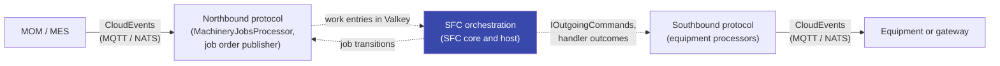

# Overall Design

MicroDCS helps build OT and manufacturing control applications with event-driven, cloud-native architecture while
staying with open standards. Instead of custom protocol glue, it uses typed CloudEvents, a transport-neutral processor
model and payloads from standard specifications.

## Design goals

* Make sequence control at ISA-95 level 2 buildable with event-driven software patterns and ordinary container
  operations.
* Rely on open standards (MQTT 5, NATS, CloudEvents, JSON Schema, OpenTelemetry, OPC UA companion specifications)
  instead of own formats.
* Take payload models from standard specifications and generate code from them where possible.
* Keep application code on typed payloads and processors, not on transport details. Writing a processor should be easy
  and safe ([D-25](porting/decisions.md#d-25)).
* Run as one small Native AOT binary in a non-root container without a shell.

## Premises

* **Event-driven, over a broker.** MQTT 5 (and NATS) carry the messages, not OPC UA client/server or PubSub. OPC UA
  information models define the semantics and the payloads ([D-4](porting/decisions.md#d-4)).
* **Metadata in the envelope.** Everything needed to route and process a payload is a CloudEvent attribute carried as a
  transport header. There are no custom transport frames.
* **A UNS-style address space.** Addresses end in `data`, `events`, `commands` or `metadata`, below a prefix and the
  scope levels ([concepts](concepts.md#intent-and-address)).
* **Persistent broker state.** The MQTT broker must keep retained messages and sessions across restarts (Mosquitto:
  `persistence true`). Without it, a broker restart loses the MES state topics until the next refresh, and messages of
  a disconnected instance are lost. NATS keeps them in JetStream.
* **Valkey is the system of record.** Job orders, SFC state, streams and dedupe claims live in one Valkey per island.
  Valkey cluster mode is out of scope; high availability comes from independent islands
  ([D-12](porting/decisions.md#d-12)).
* **Fail fast.** A component that cannot start ends the process; Kubernetes restarts it
  ([D-27](porting/decisions.md#d-27)).

## Instance roles

`MicroDcs:Roles` selects what an instance runs ([D-51](porting/decisions.md#d-51)):

| Mode | `Roles` | Description |
|---|---|---|
| Single container | `All` (default) | Processors, SFC engine and publisher in one process. For development and small sites. |
| Split | `Processor` and `Publisher` | Processor replicas scale out with shared subscriptions or a shared consumer; one publisher replica writes the state topics for the MES. A slow MES broker or a large state index then stays out of the control path. |

A publisher-only instance connects to the transport but does not subscribe. A lease in Valkey lets only one instance
publish, also during a rolling update. See [Deployment](deployment.md#shape).

## Three layers

| Layer | Responsibility | .NET part |
|---|---|---|
| Northbound protocol | OPC UA job state machine, job orders and responses, station configuration, state topics for the MES | `MicroDCS.MachineryJobs` |
| SFC orchestration | Recipe interpretation, step sequencing, dispatch, deadlines, coordination across replicas | `MicroDCS.Sfc`, `MicroDCS.Sfc.Hosting` |
| Southbound protocol | Equipment-specific CloudEvents | Application processors |

The SFC engine is not a processor. The northbound processor stays a pure OPC UA protocol handler, the southbound
processors stay pure equipment protocol handlers, and both can be tested alone. The layers meet through Valkey (the job
order script writes SFC work atomically with the job state) and through the processor API (the SFC host sends commands
by type id through `IOutgoingCommands` and gets outcomes back from the handlers). The SFC logic is a pure function, so a
different execution strategy could replace it without touching a processor.

### Several replicas

The SFC host runs on every `Processor` instance. Instances share work through a Valkey stream per scope with one
consumer group, and every change of a job's state is a compare-and-set. A crashed instance's work entries are claimed by
another after an idle time.

A response to a push command goes to the reply address of the instance that sent the command
([D-9](porting/decisions.md#d-9)). If that instance is gone, the response is lost and the action's deadline makes another
instance send the command again; equipment must therefore deduplicate on `mdcsactionkey`
([equipment contract](sfc-engine.md#the-equipment-contract)). Pull events are written to the work stream by whichever
instance receives them, so none is lost. See [SFC Engine](sfc-engine.md#running-on-several-replicas).

## Libraries and platform

| Purpose | Library |
|---|---|
| Runtime | .NET 11, Native AOT, Generic Host ([D-59](porting/decisions.md#d-59)) |
| Envelope | CloudNative.CloudEvents, behind an own `EventEnvelope` and codec ([D-14](porting/decisions.md#d-14), [D-36](porting/decisions.md#d-36)) |
| MQTT 5 | MQTTnet |
| NATS | NATS.Net |
| Valkey | StackExchange.Redis, without blocking commands ([D-7](porting/decisions.md#d-7)) |
| OPC UA models | OPC Foundation UA-.NETStandard 2.x, models only |
| Telemetry | OpenTelemetry .NET with OTLP export |
| MCP | ModelContextProtocol.AspNetCore (dev and test only) |

Processor wiring, payload descriptors and diagnostics come from a Roslyn source generator; JSON uses source-generated
serializer contexts. Nothing depends on runtime reflection.

## Southbound connectivity

### Context

MicroDCS orchestrates equipment from the SFC engine and the southbound processors. Plants run many industrial protocols
(OPC UA client/server, Modbus, S7, vendor APIs). The framework is built on CloudEvents over brokers and uses OPC UA
information models as payload definitions, not as a transport.

### Decision

MicroDCS contains no southbound industrial protocol clients. Equipment is reached over the framework's CloudEvent
transports, with the protocol translation outside the framework:

1. **A gateway or the equipment publishes CloudEvents on MQTT** (or NATS). A southbound processor subscribes to
   `data`, `events` and `metadata` and publishes `commands`. Bridges such as OPC UA to MQTT gateways or edge platforms own
   the OT protocol. The gateway contract is designed in S28 (Q-ARCH-11).
2. **A gateway, sidecar or the equipment speaks CloudEvents over Zenoh.** Zenoh becomes a full transport binding with the
   same processors and pipeline ([D-11](porting/decisions.md#d-11), S25). It suits edge and peer-to-peer set-ups.
3. **A southbound processor translates in-process.** A processor may use a protocol library, but then that is
   application code, not part of the framework.

### Consequences

* The framework stays protocol-agnostic and its dependencies stay small. Protocol licences, security patches and
  certification of the OT stack stay with the gateway.
* The SFC host runs on every replica. A direct protocol connection in each replica would let several replicas compete
  for the same equipment session, which is another reason to keep it behind a gateway that owns the connection.
* Commands are delivered at least once, so the gateway or the equipment must follow the
  [equipment contract](sfc-engine.md#the-equipment-contract).
* A gateway is one more component to deploy, secure and monitor. Its identity and topic permissions follow the
  [authorization model](security.md#acl).
* MicroDCS does not see the equipment connection. The gateway has to report equipment availability as `events` or
  `data`.

### Alternatives considered

* **An OPC UA client inside the framework.** Rejected because of the replica issue above and because it ties the
  framework to one protocol and its security model.
* **The MessagePack-RPC sidecar protocol of the Python implementation.** Dropped: it duplicated what a standard
  transport gives, and Zenoh covers the local and edge cases with the same processor model.
* **OPC UA PubSub or client/server as the main transport.** Rejected in favour of a broker with CloudEvents, which fits
  container deployments and scaling through shared subscriptions.

## History

MicroDCS started as a Python framework. The Python implementation is frozen on the
[`python-archive`](https://github.com/aschamberger/microdcs/tree/python-archive) branch. The .NET rewrite keeps its
behaviour where the parity tests require it, but its wire format and key schema are a clean break
([D-2](porting/decisions.md#d-2)). The reasons, decisions and session log of the port are in the
[design record](porting/index.md).
