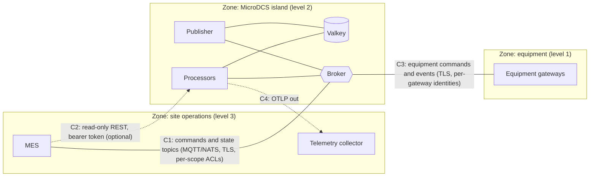

# Security and Authorization

MicroDCS does not authenticate the senders of messages itself. Identity and access control belong to the transports: the MQTT
broker or the NATS server (client identity and topic or subject permissions) and Valkey (ACL user and network access). This page
describes what the framework trusts, what it checks on top, and what the operator has to configure. Deployment details are in
[Deployment](deployment.md); reporting a vulnerability is described in
[SECURITY.md](https://github.com/aschamberger/microdcs/blob/main/SECURITY.md).

## Trust model {#trust-model}

| Boundary | Authentication | Authorization |
|---|---|---|
| MQTT broker | Kubernetes service account token (`K8S-SAT`, enhanced authentication) when `SatTokenFile` exists; user and password (`Username`, `PasswordFile`); client certificate (`TlsClientCertFile`, `TlsClientKeyFile`) | Broker topic ACLs |
| NATS server | One of: user and password, `TokenFile`, `CredsFile` (JWT and NKey seed), `NKeyFile`; client certificate | Account and subject permissions; one account per tenant ([NATS transport](nats-transport.md#tenancy)) |
| Valkey | ACL user (`User`) and `PasswordFile` | Valkey ACL rules per user, network policy |
| Management listener | Loopback only by default; on another address a bearer token from `BearerTokenFile` on every route except `/health/*` | One token, all routes ([HTTP surface](observability.md)) |

Credential files are read on every connect attempt, so a rotated secret is used by the next reconnect without a restart, and a
rejected credential does not end the retries ([D-49](porting/decisions.md#d-49)). This holds for MQTT, NATS and Valkey.

### What the framework trusts {#what-the-framework-trusts}

These behaviours decide what a broker ACL has to enforce.

1. **CloudEvent attributes come from the publisher.** `id`, `source`, `type`, `subject`, `correlationid`, `causationid` and the
   reply address are taken from the message (MQTT user properties and response topic, NATS headers and reply subject).
2. **The scope comes from `subject` and is checked against the address** (`ScopeCheck=Enforce`, the default, D-38). An address
   with scope levels must match the subject's scope, otherwise the message is rejected. On a level-0 address (no scope path) a
   message with a subject is rejected by default (`Level0Subjects=Reject`, R-6), so a client limited to its own scope cannot act on
   another scope through the unscoped address. `ScopeCheck=Off` and `Level0Subjects=Accept` exist for deployments that rely on
   transport ACLs alone; document that choice per binding.
3. **Duplicate suppression is publisher-controlled** ([D-13](porting/decisions.md#d-13)). The dedupe key is `source` plus `id`.
   A client that replays another publisher's `source` and `id` causes the genuine message to be dropped as a duplicate. Dedupe is
   only as strong as the transport's access control: give each publisher its own identity and restrict who may publish where.
4. **Replies go to the requester's address, after a check** ([D-48](porting/decisions.md#d-48)). A reply address with `$`, a
   wildcard, or below one of the instance's own prefixes is refused, and `AllowedReplyPrefixes` restricts it further. The instance's
   publish permission on the broker is still the real limit; keep it to its own prefixes and reply bases.
5. **Recipes and job payloads are data.** A recipe runs only the steps and commands its schema allows (D-44); MicroDCS does not
   execute code from messages.

## TLS {#tls}

| Connection | TLS on when | Fail instead of plaintext |
|---|---|---|
| MQTT | `TlsCaFile` exists (default `/var/run/certs/ca.crt`) | `RequireTls=true` |
| NATS | `TlsCaFile` exists (default `/var/run/certs/ca.crt`) | `RequireTls=true` |
| Valkey | `TlsCaFile` is set (the file must exist), or `ssl=true` in the connection string | `RequireTls=true` |

MQTT and NATS switch TLS on by the presence of the CA file, so a missing secret mount means plaintext. Set `RequireTls=true` in
production: the start then fails with a message naming the missing file (D-27). Credentials sent without TLS log a warning.
A client certificate without TLS is refused at start. The example manifest sets `RequireTls` for MQTT and Valkey.

## Topic and subject permissions {#acl}

With binding prefix `P`, scope levels `S1/S2`, optional discriminator `D` and the reply base `R`
([MQTT transport](mqtt-transport.md#topics), [NATS transport](nats-transport.md#subjects-streams-and-consumers)):

| Principal | Subscribe | Publish |
|---|---|---|
| MicroDCS instances | the inbound intents of their bindings under `P` (as shared subscription or queue group), `R/{instance}` | `P/#` (or `P.>`), replies to the requesters' reply bases |
| Publisher instance | none | the state topics `P/{scope}/[D/]data/...` only |
| MES or other job-order clients | their own reply base, `P/{their scope}/#` | `P/{their scope}/[D/]commands` |
| Equipment gateways | commands addressed to them | their `data`, `events` and `metadata` |

Rules:

* **Restrict each client to its own scope.** With `ScopeCheck=Enforce` the scope a processor acts on is then the client's scope.
  Do not grant scoped clients publish rights on the level-0 address.
* **One identity per principal.** The dedupe key relies on distinct publishers; never share credentials between equipment
  gateways and job-order clients.
* **Retained state topics are written only by the publisher.** Clients get read access to `state-index`, `order/+` and
  `result/+`.
* Verify a rule set with a test client that attempts a forbidden publish and subscribe before relying on it.

The syntax is broker specific (Mosquitto ACL files, NATS accounts and permissions, EMQX or HiveMQ rules).

## Valkey {#valkey}

Valkey holds the authoritative job and recipe state; anyone who can write to it can change job state.

* One ACL user per island, limited to the island's key prefix and channels; the rule is in [Deployment](deployment.md#tenancy).
  MicroDCS sends no server-wide commands (`INFO`, `CONFIG`, `CLUSTER`) and uses no keys or channels outside its prefix.
* Disable the `default` user, or give it a password nobody uses.
* Pass the password as a mounted file (`PasswordFile`), not in the connection string.
* TLS with `TlsCaFile` outside a single trusted node; allow connections only from MicroDCS pods (NetworkPolicy).
* Backups and snapshots contain job data; protect them like the database.

## Management listener {#management-listener}

The listener serves `/health/live`, `/health/ready`, the read-only REST API (`ApiEnabled`) and the dev MCP server (`McpEnabled`)
([HTTP surface](observability.md), [Inspection](inspection.md#security)).

* Loopback by default. On loopback the `Host` header must name a loopback host (DNS rebinding) and a browser `Origin` that is
  not loopback gets 403.
* Any other address needs `BearerTokenFile`; the start fails without it (R-8). Every route except `/health/*` needs the token, so
  the kubelet can probe without it. Rotate the token by replacing the file and restarting the pod.
* The REST API is read-only and off by default. MES commands stay on the message bus. Every call goes through the inspection
  service: payloads are replaced by a size marker unless `IncludePayloads` is on, results are capped (`MaxResults`), calls are
  rate-limited per caller (`RequestsPerMinute`) and logged in the `MicroDCS.Security` category with caller and route, never results.
* Never enable `McpEnabled`, `WriteEnabled` or the maintenance tools in production. Maintenance runs only in `Development` or
  `Test` and can additionally require an environment marker key in Valkey (D-45).
* The NetworkPolicy in the example manifest admits the management port only from pods labelled
  `microdcs.io/management-client: "true"`.

## Logging {#logging}

Logs carry identifiers and sizes (job ids, CloudEvent ids, types, scopes, byte counts), never message content or secrets.
Configuration that can carry a secret (`ConnectionString`, passwords) is never logged. Exception messages from libraries can still
contain values, so treat logs at `Debug` and below as sensitive. Telemetry
goes over OTLP ([Observability](observability.md)); the collector usually has wider access than the application, which is one more
reason why payloads stay out.

## Container image and supply chain {#supply-chain}

| Property | How |
|---|---|
| Minimal image | Native AOT binary in `runtime-deps:11.0-resolute-chiseled` (Ubuntu 26.04): no shell, no package manager, user `app` (1654); CI checks both (D-32) |
| Pinned inputs | Base images and scanner containers by digest, GitHub Actions by commit SHA, NuGet packages through lock files with locked restore; Dependabot proposes updates |
| Vulnerability gates | NuGet audit in the build, Trivy over the lock files, the Dockerfile and `deploy/`, Trivy over the image, daily on `main` (D-20) |
| Secrets in the repository | Gitleaks over every pull request and the full history |
| Code analysis | SonarQube Cloud quality gate on new code; workflows checked by actionlint and zizmor |
| Signed images | Pushes to `main` and `v*` tags publish `ghcr.io/aschamberger/microdcs`; each platform image and the multi-arch index are signed with cosign keyless (Sigstore), [D-55](porting/decisions.md#d-55) |
| SBOMs | Two CycloneDX attestations per platform image: the NuGet packages linked into the binary (from the app's lock file) and the OS packages of the image. The AOT binary hides its packages from an image scan, which is why the first one comes from the lock file |

### Verifying the image {#verifying-the-image}

```bash
IMAGE=ghcr.io/aschamberger/microdcs@sha256:<digest>
IDENTITY='^https://github.com/aschamberger/microdcs/.github/workflows/ci.yml@refs/(heads/main|tags/v.+)$'
ISSUER=https://token.actions.githubusercontent.com

cosign verify --certificate-identity-regexp "$IDENTITY" --certificate-oidc-issuer "$ISSUER" "$IMAGE"
# SBOMs are attested on the platform images (the index lists them: docker buildx imagetools inspect "$IMAGE")
cosign verify-attestation --type cyclonedx --certificate-identity-regexp "$IDENTITY" --certificate-oidc-issuer "$ISSUER" \
  ghcr.io/aschamberger/microdcs@sha256:<platform-digest>
```

Deploy by digest (`deploy/kustomization.yaml`) and enforce the same identity in the cluster with an admission policy (Sigstore
policy-controller or Kyverno `verifyImages`). Release images are built without build caches; `main` images reuse the caches that
only `main` runs write.

## Kubernetes hardening {#kubernetes-hardening}

[`deploy/k8s.yaml`](https://github.com/aschamberger/microdcs/blob/main/deploy/k8s.yaml) applies these settings; the kind test
(`scripts/k8s-test`) runs it in a namespace that enforces the Pod Security Standard `restricted`.

| Setting | Effect |
|---|---|
| `runAsNonRoot`, user and group 1654, `seccompProfile: RuntimeDefault` | Runs as the image's non-root user |
| `readOnlyRootFilesystem` with a size-limited `emptyDir` on `/tmp` | The container cannot change its image |
| `allowPrivilegeEscalation: false`, `capabilities.drop: [ALL]` | No extra privileges |
| Own ServiceAccount, `automountServiceAccountToken: false` | No Kubernetes API token in the pod; a projected token for MQTT `K8S-SAT` is mounted separately |
| Secrets as read-only files (mode 0440) | Read on every connect; no secret in environment variables or the ConfigMap |
| CPU, memory and ephemeral-storage requests and limits | Bounded resource use per pod |
| NetworkPolicy: default deny, egress to DNS, Valkey, the broker and the collector, ingress to the management port from labelled clients | Restricted data flow (zones and conduits below) |

## Zones and conduits {#zones-and-conduits}

A reference split along IEC 62443-3-2. Names and boundaries depend on the site; the point is which traffic crosses which boundary.



| Conduit | Crosses | Protection |
|---|---|---|
| C1 MES ↔ broker | site operations → island | TLS, one identity per MES client, publish limited to its scopes' `commands`, read-only on state topics |
| C2 MES → management API | site operations → island | Off by default; bearer token, NetworkPolicy client label, read-only, rate limit, audit log |
| C3 broker ↔ equipment | island → equipment | TLS, one identity per gateway, topic ACLs per gateway |
| C4 OTLP | island → site operations | Outbound only; no payloads in telemetry |
| Valkey, broker inside the island | none | NetworkPolicy, ACL user per island, TLS where the island spans nodes |

Each island is an independent deployment with its own Valkey ([D-12](porting/decisions.md#d-12)), so a compromised island does not
reach another island's state.

## Known gaps {#known-gaps}

| Gap | Mitigation |
|---|---|
| The dedupe key is publisher-controlled (D-13) | Distinct credentials per publisher; broker ACLs |
| TLS on MQTT and NATS follows the presence of the CA file | `RequireTls=true` |
| One bearer token for every management route; rotation needs a restart | Keep the API off unless the MES needs it; NetworkPolicy client label |
| The management listener serves plain HTTP, so the bearer token crosses the pod network unencrypted | NetworkPolicy client label; a service mesh with mTLS, or keep the API off |
| No per-processor authorization inside an instance | Bindings limit which intents an instance subscribes; broker ACLs limit who can publish them |
| The framework does not log authentication failures of the transports | Use the broker's and Valkey's own logs |

## Scanner waivers {#scanner-waivers}

Every waiver has a reason and an expiry date and is reviewed at S22 and S23 ([D-20](porting/decisions.md#d-20)). Reviewed in
S22 (2026-11-11): `.trivyignore.yaml` and the Gitleaks allowlists are empty, zizmor has no ignores (the pedantic persona
leaves two informational notes about unnamed definitions), and no SonarQube Cloud issue is accepted.

| Scanner | Finding | Scope | Reason | Expires |
|---|---|---|---|---|
| none | | | | |

## IEC 62443 alignment {#iec-62443}

An aid for assessments along the seven foundational requirements (FR) of IEC 62443-3-3, not a certification or a compliance
claim: IEC 62443 applies to the whole system and its operation, and most controls depend on the deployment.

| FR | What MicroDCS provides | What the operator provides |
|---|---|---|
| 1. Identification and authentication | MQTT: K8S-SAT, user and password, client certificates. NATS: accounts, tokens, creds, NKeys, client certificates. Valkey: ACL user. Management: bearer token. Credentials as files, re-read on reconnect | One identity per principal, secret storage and rotation, broker and Valkey accounts |
| 2. Use control | Scope check against the address, level-0 subjects rejected, reply-address check, read-only REST, maintenance only in Development or Test | Broker and Valkey ACLs per principal and scope |
| 3. System integrity | Signed images with SBOM attestations, pinned and scanned dependencies, non-root read-only container without shell, version-guarded idempotent writes | Admission policy that verifies signatures, patching cadence |
| 4. Data confidentiality | TLS to broker, NATS and Valkey (`RequireTls`), payloads kept out of logs and telemetry, secrets never logged | Encryption at rest for Valkey data and backups, certificate management |
| 5. Restricted data flow | Default-deny NetworkPolicy with explicit egress and ingress, loopback management listener by default, per-binding topic structure | Zone and conduit design, broker bridges, firewalls between levels |
| 6. Timely response to events | OTLP traces, metrics and logs; security audit category `MicroDCS.Security`; warnings for dropped messages and credentials without TLS | Collection, alerting, a security event log |
| 7. Resource availability | Bounded queues with explicit backpressure errors (D-28), fail-fast restart (D-27), resource limits, PodDisruptionBudget | Capacity planning, Valkey persistence and backup, broker limits |
