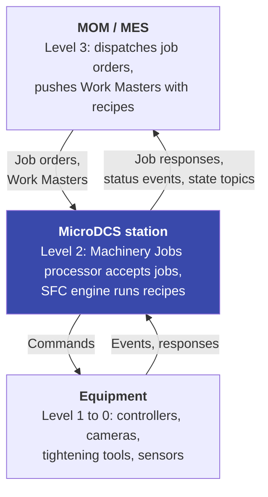
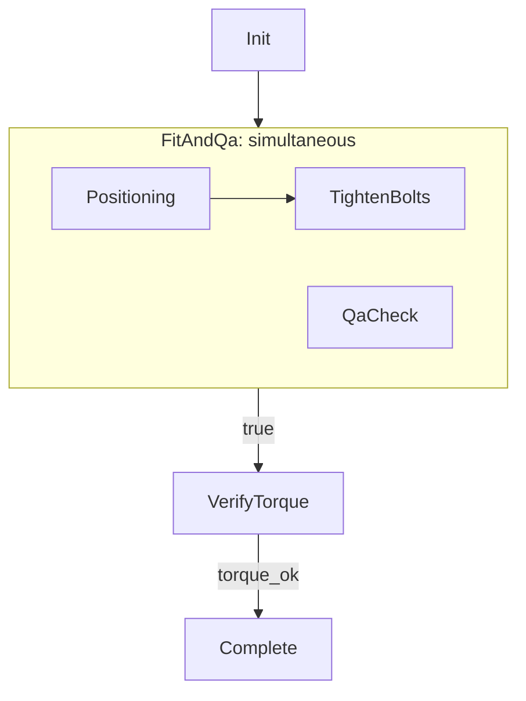

# SFC Engine

The SFC engine runs a station's recipe for each job order. It sits between the northbound job interface (OPC UA
Machinery Jobs, served by the Machinery Jobs processor) and the southbound equipment. This page explains the concepts.
The reference for the recipe fields, the rules, the build errors and the settings is [SFC core](sfc-core.md).

## The problem

The Machinery Jobs processor implements the OPC UA job order state machine: Store, Start, Pause, Resume, Stop, Abort,
Cancel and Clear from the MES. What happens between `AllowedToStart` and the end of `Running` is left open by the
specification. A station can do several things at once (a camera check next to a tightening sequence), talks to
equipment in two ways (it sends commands, or it waits for the equipment to report), and gets its recipe from the MES as
part of the Work Master.

The SFC engine fills that gap. It reads the recipe from the job's Work Master and runs it with IEC 61131-3 Sequential
Function Chart semantics.

## Scope: one station at ISA-95 level 2

MicroDCS runs at level 2, a station or cell. It receives complete job orders from the MES at level 3 and runs them
locally. Dispatching across stations and routing on a line stay with the MES.



## Sequential Function Charts

A Sequential Function Chart (SFC) is one of the languages of IEC 61131-3. It splits a process into **steps** connected by
**transitions**.

* A **step** is a state the process is in. Its **actions** are the work done while it is active.
* A **transition** is the condition that moves the process from one step to the next.
* A **selection divergence** offers several sequences; one of them is taken.
* A **simultaneous divergence** runs several sequences at the same time; all must end before the chart goes on.
* A transition back to an earlier step forms a **loop**.

In a PLC the logic inside a step or a transition is usually written in another IEC 61131-3 language. In MicroDCS the
work of an action is a CloudEvent exchange with the equipment, and a transition condition names how that exchange ended.

## Recipes

A recipe is JSON with steps, transitions, actions and divergences (`Branches` in the recipe). The MES sends it inside a
Work Master (`ISA95WorkMasterExtDataType`, field `Data`), with `DataSchema` set to
`https://aschamberger.github.io/microdcs/schemas/sfc-recipe/v1.1.0.json`. The job order names the Work Master by id.

Example: a rear axle station positions and tightens the axle while a camera checks it, then waits for the torque result.

```json
{
  "Steps": [
    {"Name": "Init", "Initial": true}, {"Name": "Positioning"}, {"Name": "TightenBolts"},
    {"Name": "QaCheck"}, {"Name": "VerifyTorque"}, {"Name": "Complete"}
  ],
  "Branches": [
    {"Name": "FitAndQa", "Type": "simultaneous", "Branches": [["Positioning", "TightenBolts"], ["QaCheck"]]}
  ],
  "Transitions": [
    {"Source": "Init", "Target": "FitAndQa", "Condition": "true"},
    {"Source": "FitAndQa", "Target": "VerifyTorque", "Condition": "true"},
    {"Source": "VerifyTorque", "Target": "Complete", "Condition": "torque_ok"}
  ],
  "Actions": [
    {"Name": "position_axle", "Step": "Positioning", "Qualifier": "N", "Interaction": "push_command",
     "TypeId": "com.example.station.position.v1", "TimeoutSeconds": 30},
    {"Name": "tighten", "Step": "TightenBolts", "Qualifier": "N", "Interaction": "push_command",
     "TypeId": "com.example.station.tighten.v1", "TimeoutSeconds": 60, "MaxAttempts": 2,
     "Parameters": {"torque_spec": "85Nm"}},
    {"Name": "camera_qa", "Step": "QaCheck", "Qualifier": "N", "Interaction": "pull_event",
     "TypeId": "com.example.station.qa_result.v1", "TimeoutSeconds": 45},
    {"Name": "verify", "Step": "VerifyTorque", "Qualifier": "N", "Interaction": "pull_event",
     "TypeId": "com.example.station.torque_result.v1", "TimeoutSeconds": 15},
    {"Name": "finish", "Step": "Complete", "Qualifier": "N", "Interaction": "push_command",
     "TypeId": "com.example.station.finish.v1", "TimeoutSeconds": 10}
  ]
}
```



The recipe is checked when the job starts, against what the station offers: the action types its processors handle,
the outcome names they declare, and the features it supports. A recipe that fails is refused with a build error, and the
job is aborted. `sfc_explain` and `sfc_dryrun` of the MCP server check and simulate a recipe without a running job
([SFC core](sfc-core.md#mcp-tools)).

### Outcomes and transitions

Every action ends with an **outcome**: a name such as `done`, `torque_ok` or `nok`, chosen by the processor that handles
the response or the event, or one of the reserved outcomes `timeout` and `error`. A transition fires when its condition
is one of the step's outcomes, or `true`; with several candidates the lowest `Priority` wins. `true` never matches a
failed action, so a failure only goes where a transition names `timeout` or `error`. When no transition matches, the job
is aborted.

### Interaction patterns

Each action declares how the station works with the equipment:

| `Interaction` | The station | Example |
|---|---|---|
| `push_command` | Sends a command and waits for the response. The southbound processor's `[Outgoing]` factory builds the command, its `[OnResponse]` handler returns the outcome. | Send a tightening program to the controller. |
| `pull_event` | Waits for an event from the equipment. The processor's `[Incoming]` handler for the event type returns the outcome. An optional `Selector` matches `Subject` or `CorrelationId`, for example against `{jobId}`. | Wait for the camera's QA result. |

Each attempt has a deadline (`TimeoutSeconds`). A push command whose deadline passes is sent again, up to
`MaxAttempts`; then, and at once for a pull event, the outcome is `timeout`.

## Three layers

| Layer | Responsibility | .NET part |
|---|---|---|
| Northbound protocol | OPC UA job state machine, job orders and responses, station configuration, state topics for the MES | `MachineryJobsProcessor`, job order publisher |
| SFC orchestration | Recipe interpretation, step sequencing, dispatch, deadlines, recovery across replicas | `MicroDCS.Sfc` (pure core), `MicroDCS.Sfc.Hosting` (Valkey host) |
| Southbound protocol | Equipment-specific CloudEvents | Application processors with `[Outgoing]`, `[OnResponse]` and `[Incoming]` handlers |

The SFC engine is not a processor. The northbound processor knows nothing of recipes, and the southbound processors
know nothing of steps; both can be tested on their own. The layers meet through Valkey and the processor API, not
through CloudEvent round trips inside the process:

* The job order script writes a `start` work entry atomically with every entry into `AllowedToStart`, a `cancel` entry
  on Abort and Stop, and `hold` and `release` entries on Pause and Resume.
* The engine moves the job order through `Running` to `Ended` (Completed or Aborted) with `job` work entries and stores
  the job response.
* Commands go through `IOutgoingCommands` to the processor that declares the type; responses and events come back
  through that processor's handlers.

The sequence logic itself is one pure function, `(graph, state, snapshot, event) -> (state, continuation, commands)`.
It reads no clock and does no I/O, so a recipe behaves the same in the simulator, in the tests and in production. The
host stores the new state, the deadline and the follow-up work in one atomic step.

## Running on several replicas

The engine runs on every instance with the `Processor` role. Instances share the work through a Valkey stream per scope
(`sfc:work:{scope}`) with one consumer group, and every state change is a compare-and-set of the job's state hash. Stream
entries are signals, not state: an entry that arrives after the state has moved on changes nothing.

| Situation | What happens |
|---|---|
| Two instances handle work of the same job | The compare-and-set lets one write; the other reads the new state and tries again. |
| An instance dies while it handles a work entry | The entry stays pending; another instance claims it after `AutoclaimIdle` (30 s). |
| An instance dies after it sent a command | The response goes to the dead instance's reply address and is lost. When the deadline passes, another instance sends the command again ([D-9](porting/decisions.md#d-9)). |
| A pull event reaches any instance | That instance writes it to the work stream; the event is offered to the waiting jobs, oldest wait first, and completes one action. |
| A platform outage (Valkey or all instances down) | When the sweeps resume, a heartbeat gap above `OutageThreshold` moves every open deadline by the gap, so running jobs are not aborted for the outage. |
| An instance starts | A recovery scan per scope re-issues work that never got a deadline and repairs lost index entries. It does not resend commands; the deadlines own them. |

## The equipment contract

Commands are delivered at least once. Re-sending after a deadline is how the engine recovers without distributed locks,
so the equipment, or the gateway in front of it, must follow these rules:

| CloudEvent attribute | Value | The same on every delivery? |
|---|---|---|
| `id` | The command id, `{jobId}:{action}#{n}`, new for each attempt | No |
| `mdcsactionkey` | `{jobId}:{action}` | Yes |
| `correlationid` | The job id | Yes |
| `subject` | The scope | Yes |
| `type` | The action's `TypeId` | Yes |
| `expiryinterval` | The time left until the attempt's deadline, less `ExpiryGrace` | No |

1. Deduplicate on `mdcsactionkey`, not on `id`. Run a repeated command at most once.
2. Answer every delivery, with `causationid` set to the `id` of the delivery it answers. A response to an earlier attempt
   still completes the action while it is open; later ones are ignored.
3. Answer before the command expires. Without a response the deadline sends the next attempt, and after the last one the
   outcome is `timeout`.

For a pull event the equipment sends an event with the scope as the first part of `subject`, the action's `TypeId` as
`type`, and a stable `id` that it keeps when it sends the event again. The pipeline treats a repeated `source` and `id`
as a duplicate for `MicroDcs:DedupeRetention` (10 minutes); a new `id` is a new event.

## Pause, Resume, Abort and Stop

* **Pause** holds the recipe at the next step boundary: no transition fires and nothing new is sent. Deadlines stop, and
  **Resume** moves them by the length of the hold, so a pause costs no attempt. Work already at the equipment runs to its
  end unless the action declares hold logic.
* **Equipment hold.** With recipe v1.1.0 a push action can declare a `Hold` and a `Restart` command. On Pause the
  station sends the hold command; if the equipment answers `held`, Resume sends the restart command
  ([D-57](porting/decisions.md#d-57), [details](sfc-core.md#equipment-hold)).
* **Abort** and **Stop** end the recipe. Open work is withdrawn in MicroDCS; the equipment is not told.

## Design decisions

* **Recipe in an opaque Work Master field.** `Data` plus `DataSchema` follow the CloudEvents pattern. The processor and
  the store do not read the recipe; a new recipe format needs only a new schema URI.
* **Pure core, separate host.** The sequence logic has no dependencies ([D-17](porting/decisions.md#d-17)); the Valkey
  host does storage, time and dispatch ([D-52](porting/decisions.md#d-52)).
* **Only the qualifier `N`.** The other IEC 61131-3 qualifiers are known and refused at build
  ([D-44](porting/decisions.md#d-44)).
* **Compare-and-set, no distributed locks.** Each state change checks the version it read. Follow-up work is written in
  the same atomic step, so no gap exists between "state changed" and "next work queued".
* **Absolute deadlines in a shared due-index** ([D-18](porting/decisions.md#d-18)) instead of timers in one process.
* **Instance-affine responses.** A response goes to the instance that sent the command. Recovery after its loss is the
  deadline, not shared routing tables ([D-9](porting/decisions.md#d-9)).
* **Station configuration first.** The MES owns the station's resource lists and Work Masters; without them no job order
  is accepted and no recipe starts.
