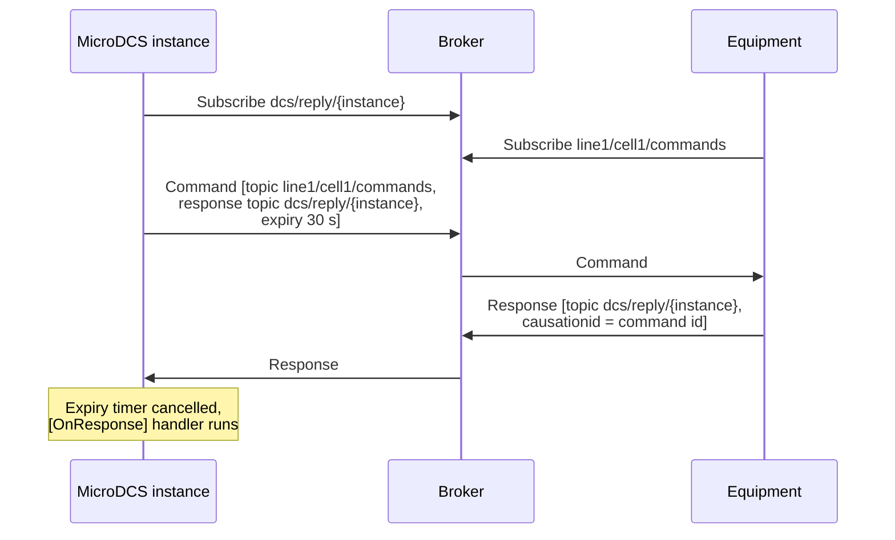

# Technical Standards

MicroDCS builds on open standards for messaging, payload description, observability and sequence logic. This page lists
them and explains which parts the framework uses. The transport pages hold the exact mapping
([MQTT](mqtt-transport.md), [NATS](nats-transport.md)).

## CloudEvents

Every message is a CloudEvent 1.0. The envelope carries the type that selects the handler, the schema of the payload,
the subject with the scope, tracing context and the delivery attributes. Processors see the transport-neutral
`EventEnvelope`; the CloudEvents SDK is used only inside the codec ([D-36](porting/decisions.md#d-36)).

* [CloudEvents specification 1.0](https://github.com/cloudevents/spec/blob/v1.0.2/cloudevents/spec.md)
* [Distributed tracing extension](https://github.com/cloudevents/spec/blob/v1.0.2/cloudevents/extensions/distributed-tracing.md)
  (`traceparent`, `tracestate`)
* [Expiry time extension](https://github.com/cloudevents/spec/blob/main/cloudevents/extensions/expirytime.md)
  (`expirytime`, plus `expiryinterval`)
* [Recorded time extension](https://github.com/cloudevents/spec/blob/main/cloudevents/extensions/recordedtime.md)
* [Correlation extension](https://github.com/cloudevents/spec/blob/main/cloudevents/extensions/correlation.md)
  (`correlationid`, `causationid`)
* [MQTT protocol binding](https://github.com/cloudevents/spec/blob/v1.0.2/cloudevents/bindings/mqtt-protocol-binding.md)
  and [NATS protocol binding](https://github.com/cloudevents/spec/blob/v1.0.2/cloudevents/bindings/nats-protocol-binding.md)

MicroDCS adds its own extension attributes:

| Attribute | Meaning |
|---|---|
| `method` | `PUT` (default when absent) or `DELETE`, used by station configuration events. |
| `mdcsactionkey` | Stable key of an SFC command, the same on every re-delivery (`{job}:{action}`). Equipment deduplicates on it. |
| `mdcserrorkind`, `mdcserrormessage`, `mdcserrorcontext` | Error description on an error event (`io.microdcs.error.v1`). The message never contains payload values. |

Payload fields marked `[CarriedAs]` travel as further extension attributes ([Processors](processors-dotnet.md#a-payload)).

Both transports use **binary content mode**: the attributes are transport headers under their own names, the payload is
the message body.

## MQTT v5

MQTT v5 is the main transport. MicroDCS relies on these features ([D-46](porting/decisions.md#d-46)):

| Feature | Use |
|---|---|
| [User properties](https://docs.oasis-open.org/mqtt/mqtt/v5.0/os/mqtt-v5.0-os.html#_Toc3901116) | CloudEvent attributes. |
| [Content type](https://docs.oasis-open.org/mqtt/mqtt/v5.0/os/mqtt-v5.0-os.html#_Toc3901118) | `datacontenttype`. |
| [Request / response](https://docs.oasis-open.org/mqtt/mqtt/v5.0/os/mqtt-v5.0-os.html#_Toc3901252) | A command carries the response topic of the sending instance (`{ReplyBase}/{instance id}`). The receiver publishes its reply there. Correlation data holds the command id; it is informational, the pipeline matches on `causationid`. |
| [Message expiry interval](https://docs.oasis-open.org/mqtt/mqtt/v5.0/os/mqtt-v5.0-os.html#_Toc3901112) | `expiryinterval`. The broker drops a message that waits longer. The sender of a command starts a local timer of the same length; when no response arrives, the processor's `[OnExpired]` handler runs. |
| [Shared subscriptions](https://docs.oasis-open.org/mqtt/mqtt/v5.0/os/mqtt-v5.0-os.html#_Toc3901250) | `$share/{SharedGroup}/…` spreads requests over the replicas of a processor. A message can still arrive twice, so the pipeline claims each event id in Valkey before the handler runs. |
| [QoS 1](https://docs.oasis-open.org/mqtt/mqtt/v5.0/os/mqtt-v5.0-os.html#_Toc3901236) and persistent sessions | At-least-once delivery. A message is acknowledged after the pipeline finished it. |
| [Retained messages](https://docs.oasis-open.org/mqtt/mqtt/v5.0/os/mqtt-v5.0-os.html#_Toc3901104) | State topics: the job order publisher keeps the current orders, results and a state index for the MES. Each retained message has a message expiry (48 h by default); a zero-byte retained message deletes the topic. |

Standard: [MQTT Version 5.0](https://docs.oasis-open.org/mqtt/mqtt/v5.0/mqtt-v5.0.html).

## NATS and JetStream

NATS is the second transport ([D-47](porting/decisions.md#d-47)). Requests go through JetStream streams with durable
consumers, so they are stored and acknowledged after the pipeline. Replies are plain inbox messages to the sending
instance (`Mdcs-Reply-To`). State topics are values in a JetStream key-value bucket with a per-message TTL. Tenancy uses
NATS accounts.

* [NATS documentation](https://docs.nats.io/), [JetStream](https://docs.nats.io/nats-concepts/jetstream),
  [key-value store](https://docs.nats.io/nats-concepts/jetstream/key-value-store)

AMQP 1.0 (S24) and Zenoh (S25) are planned transports ([D-10](porting/decisions.md#d-10),
[D-11](porting/decisions.md#d-11)). Each transport uses its own native features; there is no lowest-common-denominator
emulation.

## JSON Schema

Each payload type names its schema in `dataschema`. The documents are generated from the .NET models, compared with
golden files in the tests, and served by this site under
[`/schemas/`](https://aschamberger.github.io/microdcs/schemas/greetings/v1.0.0.json) ([D-58](porting/decisions.md#d-58)):

| Document | Content |
|---|---|
| `schemas/greetings/v1.0.0.json` | Greetings demo payloads. |
| `schemas/isa95-jobcontrol-v2/v2.0.0.json` | ISA-95 Job Control V2 data types. |
| `schemas/microdcs-jobcontrol/v1.2.0.json` | MicroDCS Job Control extension: Work Master with recipe, command and response shapes, status event, state index. |
| `schemas/machinery-jobs/v1.0.0.json` | Machinery Jobs payloads: job acceptance configuration, metadata event. |
| `schemas/sfc-recipe/v1.1.0.json`, `v1.0.0.json` | SFC recipe format. |
| `schemas/sfc-state/v1.0.0.json` | Stored SFC job state. |

* [JSON Schema](https://json-schema.org/) (draft 2020-12)

## OpenTelemetry

Traces and metrics leave the process over OTLP only; there is no Prometheus endpoint
([D-54](porting/decisions.md#d-54)). A message with `traceparent` continues the producer's trace in a consumer span, and
every event published while it runs carries the context on. Details on [HTTP surface and
observability](observability.md).

* [OpenTelemetry .NET](https://opentelemetry.io/docs/languages/dotnet/)
* [Messaging semantic conventions](https://opentelemetry.io/docs/specs/semconv/messaging/)
* [OTLP exporter configuration](https://opentelemetry.io/docs/specs/otel/protocol/exporter/)

## IEC 61131-3 SFC

The recipe format uses the Sequential Function Chart terms of IEC 61131-3: steps, transitions, action associations,
selection and simultaneous branches. It is plain JSON, not PLCopen TC6 XML, which carries graphical and PLC detail a
recipe does not need. Of the action qualifiers only `N` is supported ([D-44](porting/decisions.md#d-44)). See
[SFC Engine](sfc-engine.md).

* [IEC 61131-3 on Wikipedia](https://en.wikipedia.org/wiki/IEC_61131-3)
